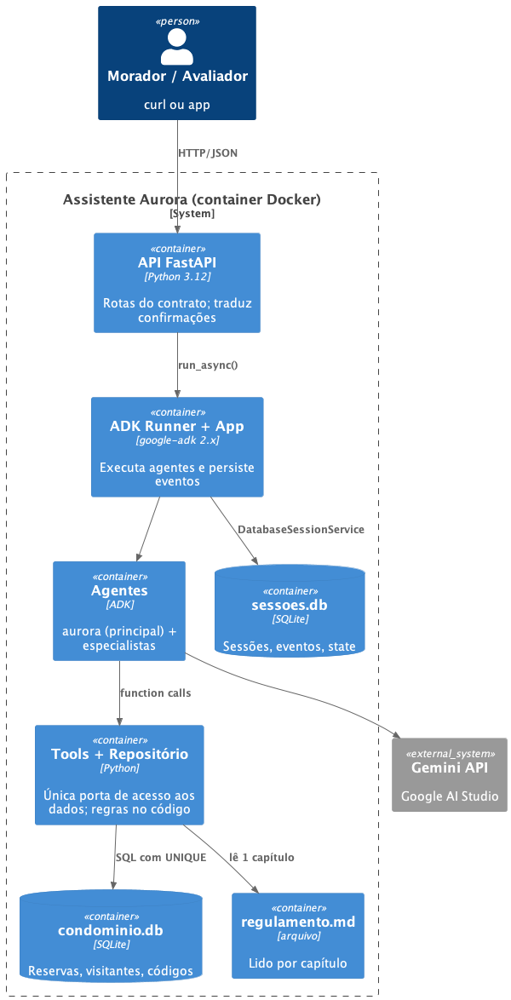
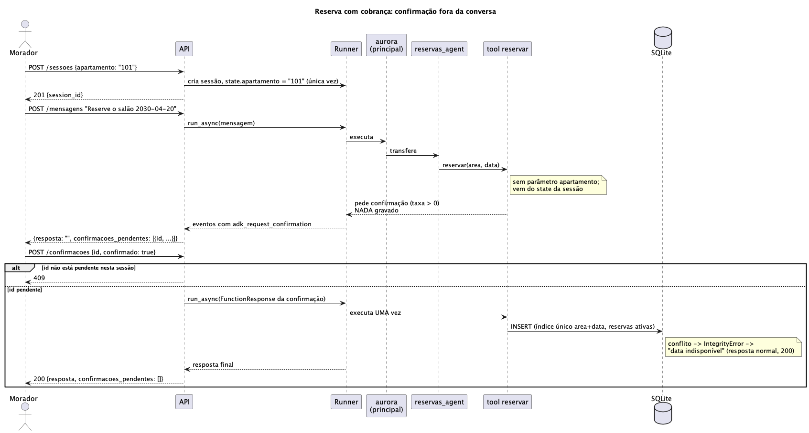

# Residencial Aurora: assistente virtual com Google ADK

API em Python (FastAPI) com um assistente construído em Google ADK 2.9.1. O modelo conduz a
conversa; as regras críticas vivem no código e continuam valendo não importa o que o morador escreva.

## Arquitetura

```
POST /sessoes/{id}/mensagens
        │
        ▼
  API FastAPI ──► Runner + App (ADK) ──► aurora (agente principal)
 (aurora/api.py)   sessão em SQLite         ├─ sub_agent  reservas_agent
                                            ├─ sub_agent  visitantes_agent
                                            └─ AgentTool  regulamento_agent
                                                   │
                      tools (aurora/tools.py) ─────┴──► repositório SQLite (aurora/repositorio.py)
```

Diagramas PlantUML (fontes em [docs/hld.puml](docs/hld.puml) e [docs/sequence.puml](docs/sequence.puml)):

**Visão de containers (C4)**



**Fluxo de reserva com confirmação**



### Agentes ([aurora/agentes.py](aurora/agentes.py))

| Agente | Responsabilidade | Como é acionado | Por quê |
|---|---|---|---|
| `aurora` | Entende o pedido e distribui. Não executa ação nem responde sobre regras. | Agente raiz do `App`. | Instruções curtas: o contexto das conversas fica pequeno. |
| `reservas_agent` | Agenda, reservas e cancelamentos. | `sub_agent` (transferência). | A conversa precisa continuar com ele (perguntar a data que falta) e é ele quem pede a confirmação da cobrança. |
| `visitantes_agent` | Lista e autoriza visitantes. | `sub_agent` (transferência). | Mesmo motivo: a autorização exige confirmação e diálogo para coletar nome e data. |
| `regulamento_agent` | Responde dúvidas lendo o regulamento por capítulo. | `AgentTool` (chamado como ferramenta). | Roda numa sessão interna isolada: os capítulos que ele lê **não entram** nos eventos da sessão do morador, só a resposta final. |

### Armazenamento

Tudo em SQLite, num volume Docker (`estado/`), sem serviço externo:
- `sessoes.db`: sessões, eventos e state, geridos pelo `DatabaseSessionService` do ADK.
- `condominio.db`: reservas e visitantes, acessados só pelas tools.

## Garantias

**1. Cobrança ou acesso só com confirmação**
- [aurora/agentes.py:29](aurora/agentes.py#L29) e [aurora/agentes.py:44](aurora/agentes.py#L44): `reservar` e `autorizar_visitante` são `FunctionTool` com `require_confirmation`. A de reservar é condicional, só quando a taxa é maior que zero ([aurora/tools.py:52](aurora/tools.py#L52)).
- [aurora/api.py:71](aurora/api.py#L71): as pendências são calculadas dos eventos persistidos (pedidos `adk_request_confirmation` sem resposta). O morador só confirma pela rota de confirmações, que envia a `FunctionResponse` do ADK ([aurora/api.py:119-131](aurora/api.py#L119)). Qualquer id fora da lista de pendentes recebe 409, inclusive o de uma confirmação já respondida.
- [aurora/tools.py:71](aurora/tools.py#L71): defesa extra. Área com taxa não é gravada se a tool não tiver recebido confirmação aprovada.
- Não depende do modelo: a pergunta "posso executar?" é do runtime do ADK. O texto "já confirmei" é só mensagem, nunca vira `FunctionResponse`.

**2. Cada sessão pertence a um apartamento**
- [aurora/api.py:104](aurora/api.py#L104): o apartamento entra no `state` da sessão uma única vez, na criação.
- [aurora/tools.py:13](aurora/tools.py#L13): toda tool lê o apartamento de `tool_context.state`. **Nenhuma tool tem parâmetro de apartamento**, então o modelo não tem como escolher outro.
- Cancelar procura só entre as reservas do apartamento da sessão ([aurora/repositorio.py:114](aurora/repositorio.py#L114)); se não achar, responde "não encontrada", sem revelar se existe de outro morador. A agenda ([aurora/tools.py:35](aurora/tools.py#L35)) devolve só livre/ocupada.

**3. Nada se perde no reinício**
- [aurora/api.py:35-39](aurora/api.py#L35): `DatabaseSessionService` em SQLite no volume `estado`. Eventos e pendências ficam no banco, e a API não guarda estado em memória.
- Reservas e visitantes estão em `condominio.db`, no mesmo volume. O restaurar só roda por comando explícito ([aurora/restaurar.py](aurora/restaurar.py)).
- Os códigos novos vêm de `MAX(seq)+1` sobre todas as linhas, inclusive canceladas ([aurora/repositorio.py:101](aurora/repositorio.py#L101)), então nunca repetem.

**4. O regulamento é consultado, não carregado**
- [aurora/regulamento.py](aurora/regulamento.py): o arquivo é dividido por capítulo; `ler_capitulo` devolve um capítulo por vez.
- [aurora/agentes.py:69](aurora/agentes.py#L69): o regulamento é um `AgentTool`. Os capítulos lidos ficam na sessão interna dele; a sessão do morador só guarda a chamada e a resposta final. O agente principal não recebe o regulamento nas instruções.

**5. Dois moradores, uma reserva**
- [aurora/repositorio.py:21](aurora/repositorio.py#L21): índice único parcial `uq_reserva_ativa` em `(area, data)` para reservas ativas. A exclusividade vale no instante do `INSERT`.
- [aurora/repositorio.py:95-112](aurora/repositorio.py#L95): `BEGIN IMMEDIATE` serializa as gravações. Em conflito, `IntegrityError` vira `None`, e a tool responde "indisponível" com 200, sem erro de servidor.
- A checagem de agenda é só conveniência: quem decide é o banco.

## Como rodar

### Pré-requisitos
- Docker com Docker Compose.
- Uma chave do [Google AI Studio](https://aistudio.google.com/).
- Opcional, para rodar sem Docker: Python 3.12+ e [uv](https://docs.astral.sh/uv/).

### Variáveis do `.env`

```bash
cp .env.example .env
```

| Variável | Descrição |
|---|---|
| `GOOGLE_API_KEY` | Chave do Google AI Studio (obrigatória). |
| `GEMINI_MODEL` | Modelo dos agentes. Vazio usa `gemini-3.5-flash-lite`. |

O plano gratuito limita as requisições por minuto, e cada mensagem gasta algumas chamadas. A API
espera e tenta de novo, então respostas podem demorar. Se o limite persistir, a API devolve 503.

### Restaurar os dados iniciais (também apaga as sessões)

Com a API parada:

```bash
docker compose run --rm api python -m aurora.restaurar
```

### Subir a API em http://localhost:8000

```bash
docker compose up --build
```

Para parar, use Ctrl+C. Para subir de novo sem restaurar, repita o mesmo comando: sessões, reservas
e visitantes continuam.

### Sem Docker (opcional)

```bash
uv sync
uv run python -m aurora.restaurar
uv run --env-file .env uvicorn aurora.api:app --port 8000
```

### Conferindo

```bash
curl localhost:8000/apartamentos/101/reservas     # RSV-1377
curl localhost:8000/apartamentos/302/visitantes   # Marina Duarte
```

Os arquivos de `dados/` são o estado inicial e não são alterados.

### Testando manualmente com o Postman

Importe [docs/aurora.postman_collection.json](docs/aurora.postman_collection.json) (Postman → Import).
A collection traz todas as rotas da API, em cinco pastas: sessão, mensagens, confirmações, eventos e
verificação.

1. Rode **Criar sessão**: o `session_id` é guardado na variável da collection.
2. Rode uma mensagem, por exemplo **Reservar salão**. A resposta traz `confirmacoes_pendentes`, e o id
   é guardado em `confirmacao_id`.
3. Rode **Aprovar** ou **Negar confirmação pendente**, e confira o efeito em **Verificação**.

Variável `base_url`: `http://localhost:8000`. Para testar outro morador, use as requisições de criação
de sessão dos apartamentos 201 e 302. Há também requisições de tentativa de burla (dados e cancelamento de outro
apartamento) para você ver as garantias funcionando.
